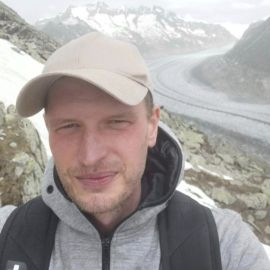

# About

Hi, I'm Thomas, and I'm a geographer through and through. However, I'm not the kind of geographer who travels the world as part of their job. That's why, instead of an Instagram account filled with beautiful travel photos, I have this GitHub page. 

I specialize in quantitative economic and urban geography, with a methodological focus on statistics and econometrics, machine learning, and GIS. During my PhD, and especially in the years that followed, I became increasingly dissatisfied with the capabilities of the proprietary software available for data analysis at the time. This led me to start working with R in 2015. A year later, I released my first R package. 

I develop open-source software for geographical analysis in Python and R. The motivation for most of what I do in this field stems from specific questions arising from my scientific work. Occasionally, however, it also involves analytical questions driven purely by personal interest. (I'm self-taught when it comes to programming, so unfortunately, some of my code shows it. Sorry about that!) 

 

## CV

### Employment

**Since 2023**: Data Scientist at Coop, Basel (CH)*

**2016-2022**: Postdoctoral researcher at Karlsruhe Institute of Technology (KIT), Institute of Geography and Geoecology, Karlsruhe

**2012-2016**: Researcher and project manager at Institut für Stadt- und Regionalmanagement (ISR), Munich

**2010-2012**: External GIS project consultant at Autonome Provinz Bozen/Südtirol – Landesinstitut für Statistik (ASTAT), Bozen (IT)

**2008-2013**: Research assistant at Georg August University Göttingen, Institute of Geography

*My open-source software projects are developed independently in my personal time and are not affiliated with, endorsed by, or representative of my employer. Any views or opinions expressed through these projects are my own and do not necessarily reflect those of my employer.

### Education

**2009-2014** PhD in Geography at the University of Göttingen, graduated with the degree *Dr. rer. nat*

**2002-2008** Studied Geography at the University of Göttingen, graduated with the degree of *Diplom-Geograph* (Master equivalent)

## Scientific work

### Research topics

During my active career as a scientist, these were my primary research focus areas:

- Retail geography
  - Consumer behavior (store and channel choice), especially in the context of multi-channel retailing
  - Market areas of stores, especially with respect to the effect of spatial clustering
  - Location analysis and store performance models

- Health geography
  - Spatial accessibility of health care locations
  - Spatial analysis of epidemic spreads
  - Evaluation of the effectiveness of non-pharmaceutical interventions (NPI)

- Regional economics
  - Economic growth and disparities in South Tyrol
  - Methods of regional analysis
  - Economic impact of tourism and tourist attractions

### Academic profiles and links

- See my [ResearchGate profile](https://www.researchgate.net/profile/Thomas-Wieland-5)
- See my [Google Scholar profile](https://scholar.google.com/citations?user=zaddjHsAAAAJ&hl=de)
- See the full list of all publications and presentations [here](files/Publications_Wieland_2026-10-11.pdf)
- See my former [staff page at KIT](https://www.ifgg.kit.edu/mitarbeiter_wieland.php)

 

---

© [Thomas Wieland](mailto:geowieland@googlemail.com) 2026

[Start](index.md) | [About](about.md) | [Software projects](projects.md) | [Privacy Notice](privacy)